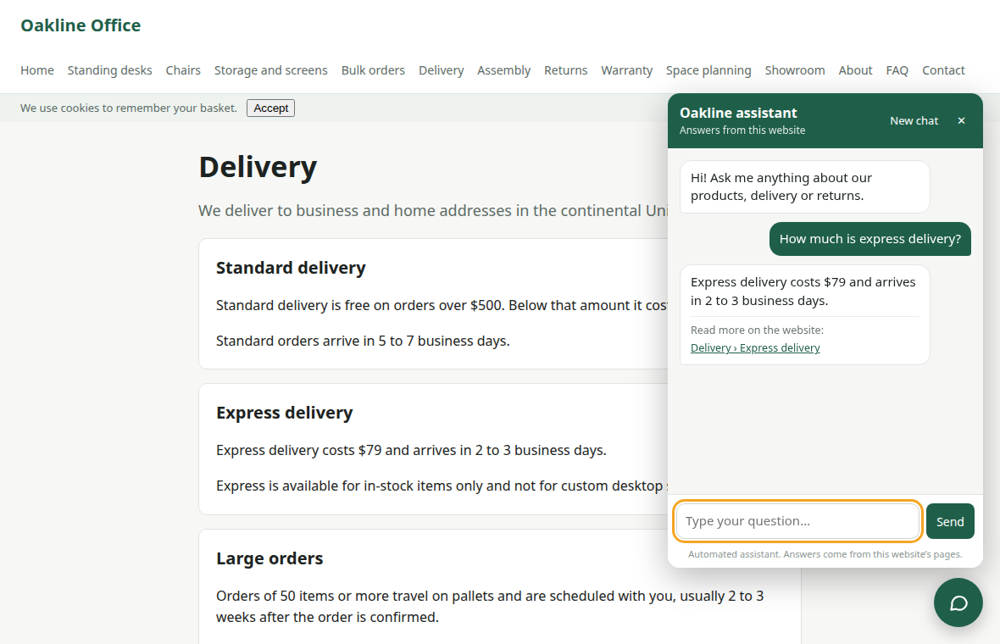
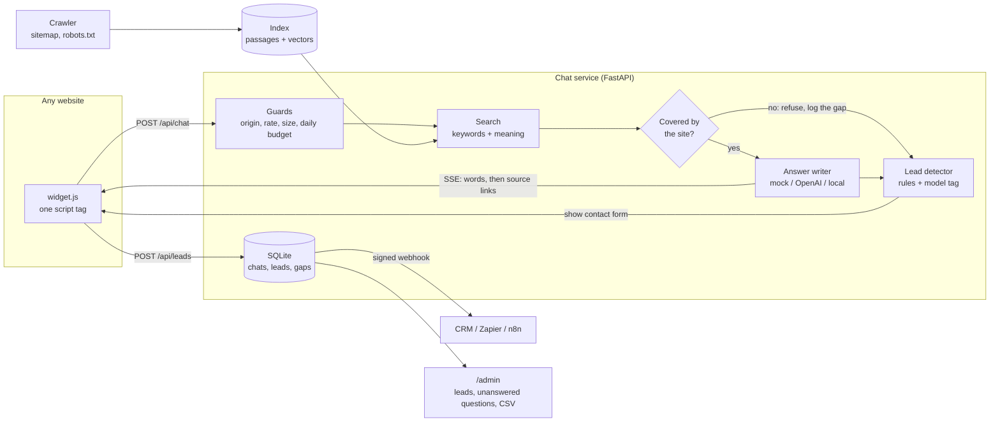
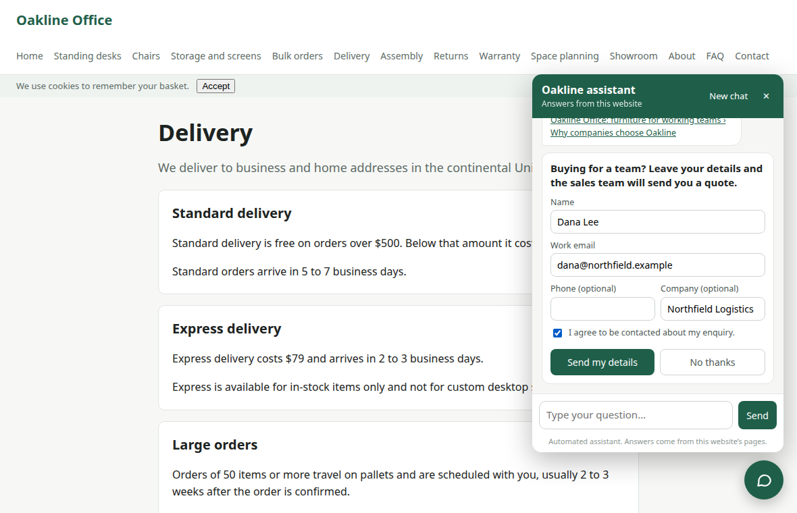
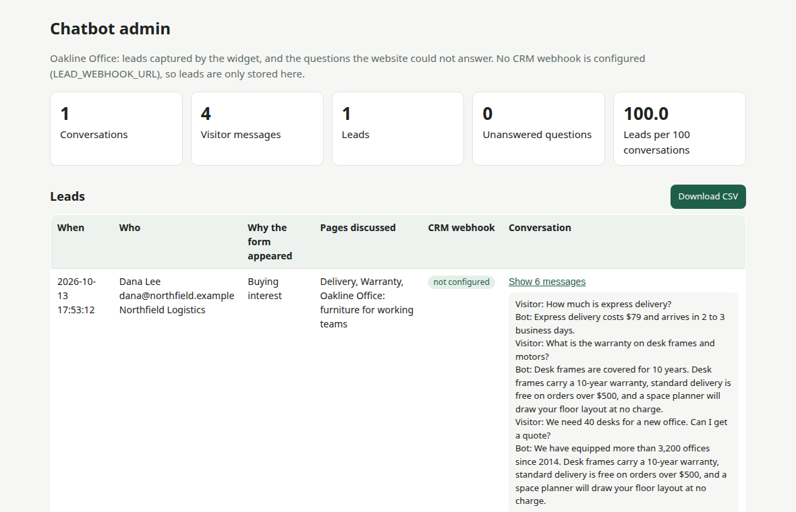

# Embeddable website chatbot with lead capture

A chat widget you add to any website with **one script tag**. It answers visitors from the
site's own pages, streams the reply word by word, links to the page it used, and turns
interested visitors into leads that arrive in your CRM with the conversation attached.



Built for a business that wants its website to answer questions at any hour **without** a
chatbot that invents prices and policies, and that wants a contact out of the visit.

- **Grounded.** Answers come from passages of the website. If the site does not cover the
  question, the bot says so and offers a person instead of guessing.
- **Lead capture that does not depend on a model.** Rules spot buying interest ("a quote for
  40 desks", "can someone call me") on every message. A model can add to them if you switch
  that on, and can never switch them off.
- **Runs with no API key.** A built-in mock answer writer makes the whole product work
  offline. One setting switches to OpenAI or to a local model.
- **Protects your API bill.** Origin allow-list, rate limit, message-size cap and a daily
  budget are all checked before any model is called.

## Try it in one minute

```bash
git clone https://github.com/BelAnas/website-chatbot-widget.git
cd website-chatbot-widget
python -m venv .venv && source .venv/bin/activate
pip install -r requirements.txt
python -m chatbot.cli serve
```

```
Demo website with the widget:  http://127.0.0.1:8022/
Leads and unanswered questions: http://127.0.0.1:8022/admin   (token: a-random-token)
Answer writer: mock   Search: hybrid   Index: 66 passages
```

Open http://127.0.0.1:8022/, click the chat button and ask *"How much is express delivery?"*,
then *"We need 40 desks for a new office. Can I get a quote?"*. The demo site is Oakline
Office, a fictional office-furniture supplier (14 pages, written for this project). The first
start downloads a 70 MB embedding model once; nothing else leaves your machine.

Or from the terminal:

```
$ python -m chatbot.cli ask "How much is express delivery?"
Express delivery costs $79 and arrives in 2 to 3 business days.
  source: Delivery › Express delivery  /demo/delivery.html#express-delivery

$ python -m chatbot.cli ask "What is the capital of France?"
I could not find that on the Oakline Office website, so I would rather not guess.
  [contact form offered: not_covered]
```

## Put it on your own website

```bash
# 1. Read your site (sitemap first, then links; robots.txt is respected)
python -m chatbot.cli ingest https://www.your-site.com

# 2. Say which website may use the service, and start it
ALLOWED_ORIGINS=https://www.your-site.com SITE_NAME="Your Company" python -m chatbot.cli serve
```

```html
<!-- 3. Add one line to your pages -->
<script src="https://chat.your-domain.com/widget.js" data-title="Ask us" data-color="#1f5f4a" defer></script>
```

The widget is one file of 18 KB (6 KB compressed), with no framework and no build step. Its
styles live in a shadow root, so your CSS cannot break it and it cannot break yours.

## How it works



1. **Crawl.** The crawler takes the page list from the sitemap (or follows same-site links),
   and keeps the main text of each page. Menus, footers, cookie banners and scripts are dropped.
2. **Index.** Pages are split at their headings. Each section is indexed for keyword search
   (BM25) and for meaning search (a sentence-embedding model that runs on CPU).
3. **Guard.** Every request is checked for origin, rate, size and the daily budget before
   anything else happens.
4. **Retrieve.** The two searches are merged by reciprocal rank fusion. If no passage is close
   enough in meaning, the question is refused and recorded as a content gap.
5. **Answer.** The model gets the top passages and strict rules (only these excerpts, three
   sentences, never guess). Its words are forwarded to the browser as server-sent events. It
   can end an answer with a tag such as `[[SALES]]` or `[[NOT_COVERED]]`; the service removes
   the tag from the stream and uses it as a signal.
6. **Capture.** Buying interest or a request for a person (spotted by rules), or an unanswered
   question, shows a contact form in the chat. An email typed straight into the chat is captured too.
7. **Notify.** The lead is stored with the transcript and the pages discussed, then posted to
   your webhook with an HMAC signature.



The admin page lists leads and the questions the site could not answer, which is a to-do
list for the site's content.



## Results

Everything below was produced by commands in this repository. The questions are split in two
halves: choices (search mode, refusal threshold, rule patterns) were made on the *dev* half,
and the numbers here are from the held-out *test* half.

| What | Result | Command |
|---|---|---|
| Automated tests | **84 passed** in about 2 s, offline, no key | `pytest -q` |
| Widget in a real browser | **15 of 15** checks (streaming, source links, lead form, second origin, phone width, HTML shown as text) | `python -m scripts.browser_check` |
| Right page in the top 3, hybrid search (default) | **89.7%** (39 questions) | `python -m evals.run` |
| Right page in the top 3, meaning search only | 94.9% | same |
| Right page in the top 3, keyword search only | 82.1% | same |
| Site questions let through by the scope gate | **94.9%** (39 questions) | same |
| Off-topic questions refused | **93.3%** (15 questions) | same |
| Questions about the business that the site does not answer, refused by the gate alone | 37.5% (8 questions) | same |
| Lead rules, precision | **100%** (44 messages, 22 leads) | same |
| Lead rules, recall | **81.8%** | same |
| Mock writer: answer contains the fact on the website | 64.1% (39 questions) | same |
| Mock writer: follow-ups answered ("and express?") | 7 of 10 | same |
| Search time per question | 5 ms | same |
| First word on screen, mock writer (median) | 64 ms | same |
| Widget size | 18,107 bytes, 6,250 gzipped | same |
| Local llama3.2 (3B) as the writer: answer contains the fact | **85.0%** (20 questions) | `OPENAI_BASE_URL=http://localhost:11434/v1 OPENAI_MODEL=llama3.2-cpu python -m evals.run --provider openai --limit 20` |
| Same model: uncovered business questions flagged as not covered, form offered | 6 of 6 | same |
| Same model: follow-ups answered | 5 of 5 | same |
| Same model: site questions refused (by the gate or by the model) | 15.0% (3 of 20) | same |
| Same model: sales tag added to an ordinary question | 40.0% (8 of 20) | same |
| Same model: first word, median (3B model on a shared CPU) | 9.9 s | same |

How to read these:

- **Hybrid against meaning-only search.** On the dev half the two tied on mean reciprocal rank
  (0.923) and hybrid led on top-3 (97.4% against 94.9%), so hybrid is the default. On the test
  half meaning-only search was ahead by two questions out of 39. This data does not separate
  them. Hybrid stays the default because keyword search is what finds exact product names and
  codes; `SEARCH_MODE=dense` switches it.
- **The gate catches off-topic questions, not missing details.** "Do the chairs come in red?"
  looks like the chairs page, so a similarity threshold lets it through. Saying "the site does
  not state that" is the model's job (it marks such answers with a tag), and the mock writer cannot do it.
- **The mock writer quotes sentences.** It cannot rephrase or combine facts, so 64% is its
  ceiling, not the product's. It exists so everything runs without a key.
- **Lead recall of 82% means four missed messages**, for example "we have a budget of $20k for
  desks, what can you offer". They are listed in `evals/report-fastembed.json`.

## Real-model check

The paid OpenAI path was **not run** for this build: no API key was available, so nothing was
spent. The same code path (the OpenAI-compatible client, streaming, the prompt, the tags) was
run against a local 3-billion-parameter llama3.2 through Ollama, on a sample of the test half.
The last six rows of the table come from that run.

That run changed the design twice:

- **Tool calling was replaced by tags.** The first version gave the model a tool for asking
  for the contact form. The local model called the tool on all 28 questions that reached it and
  wrote no answer at all (that report is kept as `evals/report-live-llama3.2-toolcall-version.json`). With a
  tag at the end of the answer instead, the same model gave the fact on the website in
  85.0% of answers, and a misused tag can no longer erase an answer.
- **The model's sales tags are off by default.** The small model added `[[SALES]]` or
  `[[HUMAN]]` to 40.0% of ordinary questions. The rules alone were right every time they
  fired, so only the rules show the form unless `MODEL_LEAD_TAGS=1`. The model's
  `[[NOT_COVERED]]` tag stays on: it is what declined the uncovered questions.

A 3B model also makes mistakes a larger one would not. Asked about PayPal, it flagged the
question correctly but wrote "we do not accept PayPal", which the site never says. All its
answers are in `evals/report-live-llama3.2.json`. Before going live on a hosted model, run
the same command with `OPENAI_API_KEY` set. The 20 answers of this run used 8,761 input and 729
output tokens, which at the listed gpt-4o-mini prices would be about $0.0018 (an estimate:
the two models count tokens differently).

## Lead webhook

Set `LEAD_WEBHOOK_URL` and `LEAD_WEBHOOK_SECRET`. Each lead is posted once, with up to three
attempts when the receiver is down:

```json
{
  "event": "lead.created",
  "site": "Oakline Office",
  "lead": {
    "id": 1, "name": "Dana Lee", "email": "dana@northfield.example", "phone": "",
    "company": "Northfield Logistics", "reason": "buying_interest",
    "interest": "Delivery, Warranty, Standing desks", "source": "form", "consent": 1,
    "page_url": "https://www.your-site.com/delivery", "created_at": "2026-10-13 17:02:39"
  },
  "transcript": [{"role": "user", "content": "We need 40 desks for a new office. Can I get a quote?"}]
}
```

The request carries `X-Webhook-Timestamp` and `X-Webhook-Signature` (HMAC-SHA256 of
`<timestamp>.<body>`). `scripts/webhook_receiver.py` is a 40-line receiver that verifies it:

```
$ python -m scripts.webhook_receiver --port 8023 --secret s3cret
waiting for leads on http://127.0.0.1:8023/leads
lead received, signature valid: Dana Lee <dana@northfield.example> reason=buying_interest interest='Standing desks'
```

## Configuration

Copy `.env.example` to `.env`. The main settings:

| Setting | Default | Meaning |
|---|---|---|
| `LLM_PROVIDER` | `mock` | `mock` (offline) or `openai` (any OpenAI-compatible API) |
| `OPENAI_API_KEY`, `OPENAI_MODEL` | empty, `gpt-4o-mini` | Used when the provider is `openai` |
| `OPENAI_BASE_URL` | empty | `http://localhost:11434/v1` for a local Ollama model |
| `MAX_OUTPUT_TOKENS` | `220` | Cap on the length, and so the cost, of one answer |
| `MODEL_LEAD_TAGS` | off | `1` lets the model's own `[[SALES]]` / `[[HUMAN]]` tags show the form too |
| `SITE_SOURCE` | the demo site | A folder of `.html` files or the address of a site to crawl |
| `ALLOWED_ORIGINS` | empty | Websites allowed to embed the widget, comma separated |
| `SEARCH_MODE` | `hybrid` | `hybrid`, `dense` or `bm25` |
| `MIN_RELEVANCE` | `0.63` | Similarity under which a question is refused |
| `RATE_LIMIT_PER_MINUTE` | `20` | Messages per visitor per minute |
| `DAILY_MESSAGE_BUDGET` | `2000` | Messages per day for the whole site |
| `LEAD_WEBHOOK_URL`, `LEAD_WEBHOOK_SECRET` | empty | Where leads are posted, and the signing secret |
| `ADMIN_TOKEN` | random at start | Token for `/admin` |

To use a real model:

```bash
LLM_PROVIDER=openai OPENAI_API_KEY=sk-... python -m chatbot.cli serve
# or, free and local:
LLM_PROVIDER=openai OPENAI_BASE_URL=http://localhost:11434/v1 OPENAI_MODEL=llama3.2 python -m chatbot.cli serve
```

## Project structure

```
chatbot/
  crawl.py        reads a site (sitemap, robots.txt, links) and cleans the HTML
  chunking.py     splits pages into passages at their headings
  bm25.py         keyword search
  embed.py        embedding model (fastembed) and the offline stand-in
  index.py        the site index and the hybrid search
  engine.py       one message in, a stream of events out: the heart of the product
  llm.py          mock and OpenAI-compatible answer writers, the prompt, cost tracking
  leads.py        lead rules, form validation, signed webhook
  guards.py       rate limiter and origin check
  store.py        SQLite: conversations, leads, unanswered questions
  api.py          FastAPI: chat stream, leads, admin, widget file, demo site
  cli.py          serve, ingest, search, ask, leads
  static/widget.js    the embeddable widget
  static/admin.html   leads and unanswered questions
demo_site/        the fictional company's website (built by scripts/build_demo_site.py)
evals/            labelled questions and messages, the evaluation script, its reports
scripts/          demo site builder, browser check, sample webhook receiver
tests/            84 offline tests
```

## Limits

- The evaluation sets were written by the author for a 14-page demo site, not collected from
  real visitors. Real traffic is messier, and the thresholds should be re-measured on it
  (`python -m evals.run` does that in a minute once the questions are replaced).
- The source links under an answer are the passages the model was given. They are not
  sentence-by-sentence citations, and nothing checks that each figure in a model's answer
  appears in a passage.
- The crawler reads HTML that the server sends. Pages that only appear after JavaScript runs,
  PDFs and pages behind a login are not read. Re-crawling is a command, not a schedule.
- English only: the stop-word list, the stemmer and the lead rules are English.
- The rate limit and the daily budget are kept in memory and in one SQLite file, so they are
  per process. Several servers behind a load balancer need a shared store such as Redis.
- The origin check stops other websites from using the widget in a browser. A script outside
  a browser can fake the header; the rate limit and the daily budget are what stop that.
- One website per running service. Serving several sites from one service needs a site key
  on each request and one index per site.
- An email typed into the chat is stored as a lead without the consent tick box that the
  form has. Whether that fits your privacy rules is a decision for the site owner.
- No hand-over to a live human agent: "talk to a person" collects contact details.

## License

MIT. See [LICENSE](LICENSE).
